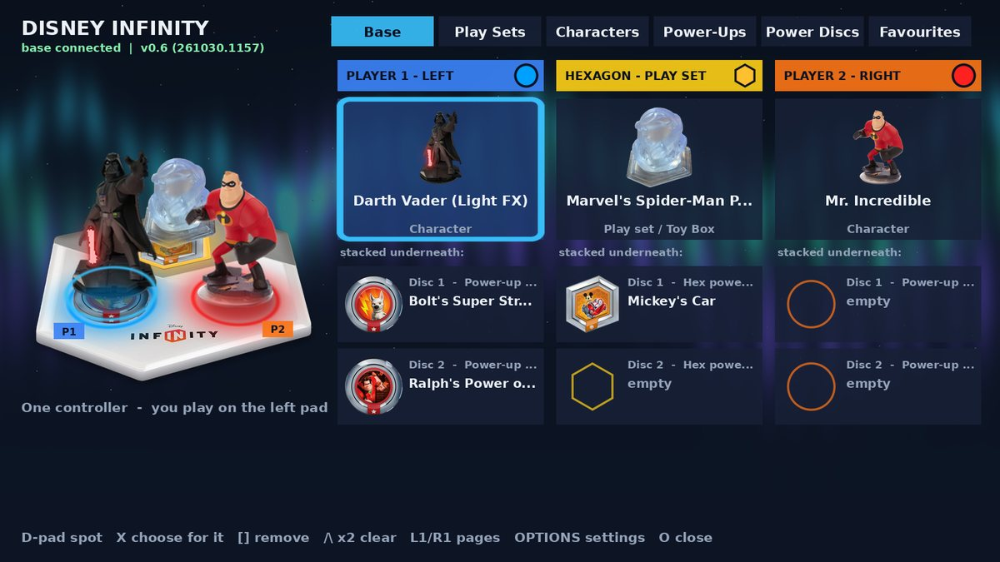
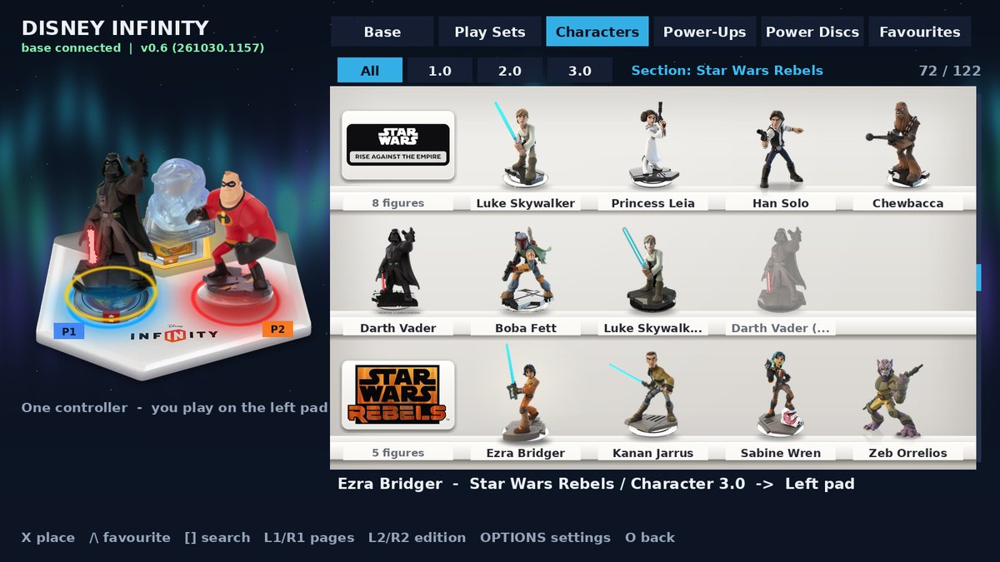
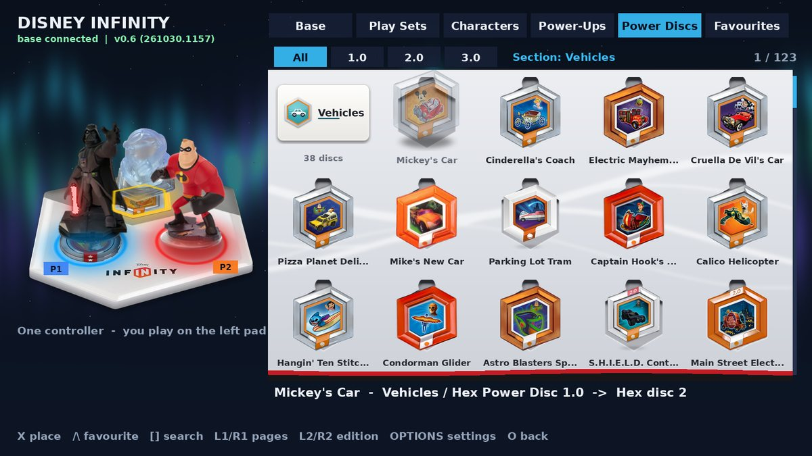
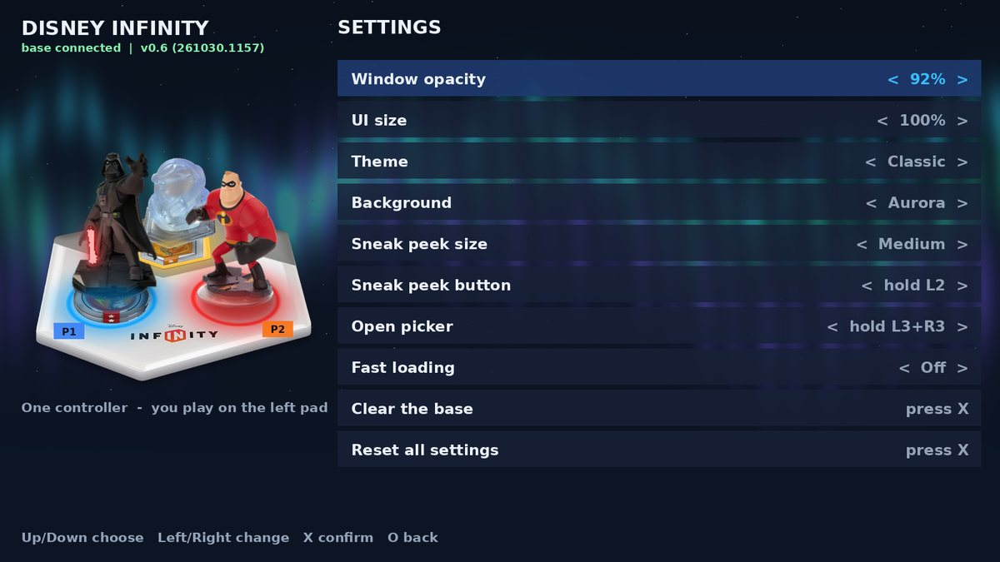
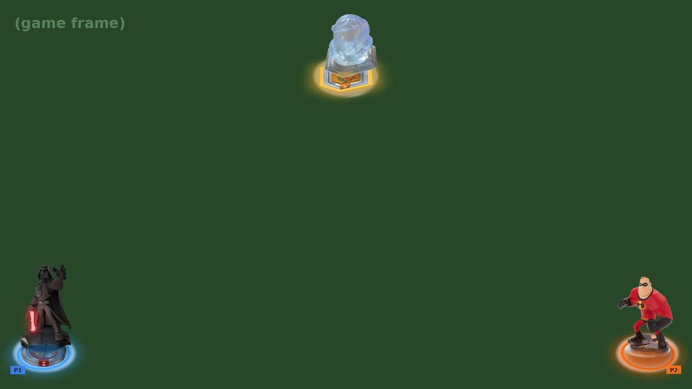
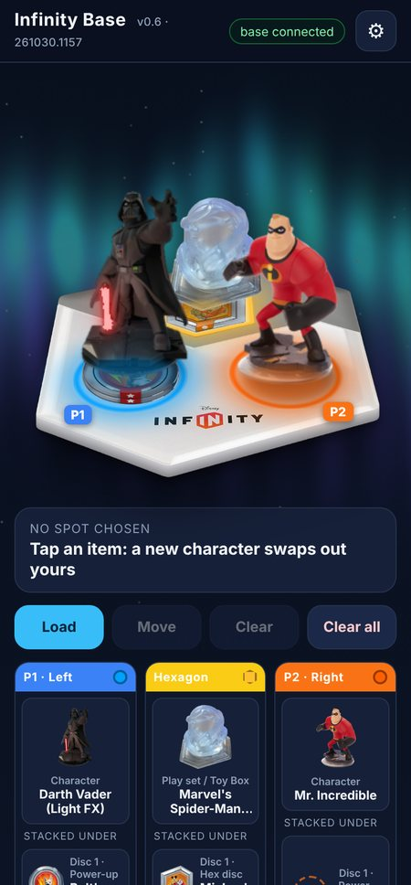
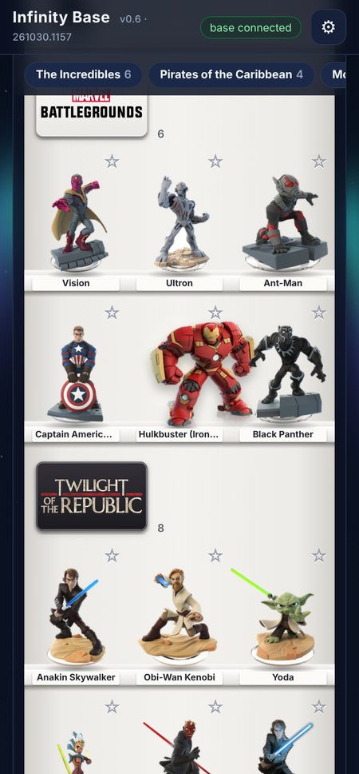

# Virtual Infinity Portal for PS5

Play the **PS4 Disney Infinity 2.0 and 3.0** games on a jailbroken PS5 **without the physical
Infinity Base**. One ELF payload gives you:

- **A virtual Infinity Base** the game believes is plugged in: every 1.0 / 2.0 / 3.0 character,
  power disc and play set piece (322 items). Levels and skill-tree progress are saved per figure.
- **A TV picker** drawn by the PS5 system UI (hold **L3 + R3**):
  - figures standing on franchise shelves, power discs in a collector's album;
  - a 3D base with **lights that behave like the real base**, Light FX sabers and Glowing Buzz;
  - search, favourites, and a **sneak peek** of the base while you play (hold **L2**).
- **A phone remote** in any browser on your Wi-Fi (`http://<PS5 IP>:8766`).
- **Themes and backgrounds:** Classic, Clear (see-through), Light, Crimson, Neon, with Starfield,
  Aurora, Toy Box or **your own photo**.
- **The game's rules:**
  - one character per player, and a new one swaps the old one out;
  - two power discs under each character;
  - up to three pieces on the hexagon, only one of them a play set.

> **[Download the latest release](../../releases/latest)**: `diinject.elf` plus the ready-made
> `data/dimod` folder (figure art included).

## Screenshots

**TV picker**

| Base: what's on each pad | Characters on their franchise shelves |
|---|---|
|  |  |
| **Power discs in the collector's album** | **Settings** |
|  |  |

**Sneak peek** while you play (hold L2): the hexagon at the top, each player's pad in a bottom corner.



**Phone remote**

<p>

&nbsp;

</p>

<sub>These screenshots come from the PC test harness. It runs the payload's real picker code and
draws its output with a stand-in for the PS5 renderer, over a plain "game frame" backdrop.</sub>

## Quick install

1. **Update the game.** Install Disney Infinity's final update. Figures released after the game
   launched are rejected by an unpatched game: Force Awakens, Marvel Battlegrounds, Alice Through
   the Looking Glass and Finding Dory on 3.0.
2. **Copy the data folder.** FTP the release's `data/dimod` folder to the PS5, so that
   `/data/dimod/web/index.html` exists. When updating, replace the whole `/data/dimod/web` folder
   and keep `tags`, `config.ini` and your favourites (your figures' progress lives in `tags`).
3. **Send the payload.** Send `diinject.elf` to your ELF loader, for example
   `socat -u FILE:diinject.elf TCP:<ps5-ip>:9021`, or pick it in etaHEN's payload menu.
4. **Check the build.** A notification says *"virtual base v0.6 is active (build …)"*. The TV
   picker and the phone show the same build number. A red warning means the ELF and the web
   folder come from different zips.
5. **Play.** Start Disney Infinity 2.0 or 3.0, wait for **"virtual base connected!"**, then hold
   **L3 + R3** for the picker or open `http://<PS5 IP>:8766` on your phone.

| Button (TV picker) | |
|---|---|
| L3 + R3 | open / close (change it in Settings > Open picker) |
| L1 / R1 | pages: Base · Play Sets · Characters · Power-Ups · Power Discs · Favourites |
| L2 / R2 | edition filter: All, 1.0, 2.0, 3.0 |
| Cross | place (on the Base page: choose a spot first) |
| Triangle | favourite |
| Square | search (on the Base page: remove) |
| Triangle ×2 | clear the whole base (Base page) |
| OPTIONS | settings |
| Circle | back / close |

> **Status:** run on a 13.60 PS5 with Disney Infinity 2.0 and 3.0. Firmware 7.00–13.60 is
> supported by design and covered by host tests, but other versions haven't been run on a
> console yet. If something goes wrong, open an issue with `/data/dimod/diinject.log`.

---

## Compatibility

| | |
|---|---|
| **Games** | Disney Infinity 2.0 and 3.0 for PS4, any region / version. No per-version offsets: the payload reads the game's own import tables at runtime. Detected by title ID (US 2.0 `CUSA00600`, US 3.0 `CUSA01705`, EU 3.0 `CUSA01862`) or by the game's title in `param.sfo`. Add other IDs with `title_ids=` in `config.ini`. |
| **Console** | Jailbroken PS5 on **7.00 to 13.60** with an ELF loader (etaHEN, elfldr on port 9021...). See *Firmware* below. |
| **Figures** | Generated on first use, or drop your own 320-byte dumps (real figures, Dolphin / RPCS3 / shadPS4 figure files) into `/data/dimod/tags` with **any** file name. They are identified by decrypting them. |

**Firmware.** The game hook and the phone remote need nothing firmware-specific beyond the
payload SDK's kernel tables, which cover every version from 7.00 to 13.60. The TV picker draws
inside SceShellUI and gets in one of two ways, picked at runtime:

| Firmware | TV picker runs through |
|---|---|
| 7.00 – 8.20, 11.00 – 13.60 | the ShellUI frame hook (Application.Update, patched while ShellUI is stopped, verified) |
| 9.60 with etaHEN | the same hook, chained after etaHEN's |
| 8.40 – 8.60, 9.00 – 9.60, 10.00 – 10.60 | its own render thread (ShellUI's main-thread check switched off, one verified byte) |

Before writing anything, it checks the firmware. If ShellUI can't be patched safely, or the
patched bytes don't read back right, it puts the original bytes back and leaves ShellUI alone.
You then get no TV picker, the phone remote still works, and the log says why. 13.60 is the
best-proven version. The others follow the same code paths but haven't been run on a console
with this payload yet.

**Runs alongside the LEGO Virtual Toy Pad.** The overlay has its own port (39261), its own
files in `/system_tmp` (`dimodovl_*`) and its own library name (`libDimodOverlay.so`). It never
picks up the LEGO payload's renderer, and the two don't block each other. Other ShellUI overlays
that also hook Application.Update (Common FPS etc.) are chained, not replaced.

**What's in it:** all 322 items the game knows: 122 characters (Crystal, Glowing and Light FX
variants included), 19 play set and Toy Box game pieces, 181 power discs (63 from 1.0, 89 from
2.0, 29 from 3.0). The **1.0 Starter Play Set is one piece** (one crystal) holding The
Incredibles, Pirates of the Caribbean and Monsters University: place it and all three are
there, just like the real one; searching any of the three finds it.

## TV picker

Hold **L3 + R3** in game (change it in Settings > Open picker, or `menu_buttons`). While it is open the game gets no input.

**Pages:** L1 / R1 switch between **Base · Play Sets · Characters · Power-Ups · Power Discs ·
★ Favourites**. On every item page **L2 / R2** filter by edition (All, 1.0, 2.0, 3.0).

**The display:** characters and play set pieces stand on the shelves of a white display case,
characters on a shelf per franchise (The Incredibles, Cars, Marvel's The Avengers, Star Wars...,
in `tools/char_groups.tsv`), each with its name card on the shelf's edge. Power-Ups and Power
Discs sit in the cut-outs of a collector's album. The highlighted figure steps forward off its
shelf with a light behind it; the highlighted disc rises out of its slot. Picking one lifts it
away, and it drops onto the base. Opening a shelf page (or another edition) swings the case's
glass doors open; opening an album page, another edition or moving into another section turns a
page of the album (backwards when you go back). The phone remote has the same shelves, album,
doors and page turns (touch to lift, let go to place).

**Shelf plaques:** every shelf and disc section has a plaque of the same size: the franchise logo
on a white plate (a dark plate for light logos), or the section's name where there is no logo.
Characters are on 26 shelves: the 1.0 to 3.0 play set franchises plus Mickey & Friends, Frozen,
Wreck-It Ralph, Phineas and Ferb, Aladdin, Big Hero 6, TRON: Legacy, Zootopia and Disney Originals.
Logos go in `tools/plaques` (see its README).

**Disc sections:** Power-Ups come in **Boosts · Special Attacks · Team-Ups & Strikes · Costumes**,
Power Discs in **Vehicles · Mounts · Gadgets & Weapons · Terrains · Skies**. Each section starts a
new row with a header tile (name and how many), and the section you're in is shown next to the
edition buttons. The sections are in `tools/disc_groups.tsv` (one line per disc): move a disc or
rename a section there and rebuild.

**Light FX figures:** Anakin, Obi-Wan, Yoda, Luke, Darth Vader, Kanan and Kylo Ren's lightsabers
glow in their own colour, as bright as the light of the pad they stand on (fades and flashes
included), the way the real figures carry the base's light up into the blade. Dark pad, unlit
blade. On the TV picker, the sneak peek and the phone.

**Glowing Buzz Lightyear** is glow-in-the-dark like the real one: his white and green armour
charges while his pad is lit, glows green when the pad goes dark, and fades over about 20
seconds (only a faint glow in the light). He goes on fully charged.

The effect layers (`g<id>.png`) are made by the build from each figure's art; the figures,
colours and kind of effect are in `tools/lightfx.tsv`.

**Swap animation:** whatever leaves a spot lifts off the base and fades, the new piece drops on
with a small bounce, on the TV picker, the sneak peek and the phone. With fast loading on, the
picker waits for the drop to finish (about a second) before it closes.

| Item pages | |
|---|---|
| D-pad / left stick | move |
| Cross | place (a gold ring on the base shows where it will go) |
| Triangle | add / remove favourite |
| Square | **search** everything (on-screen keyboard; Square deletes a letter, Up jumps into the results) |
| Circle | back to the Base page |
| OPTIONS | Settings |

**The base** is drawn the way it sits on a table in front of you: tilted back, with its side
edge and shadow. Characters and play set pieces **stand on their pads** on their own bases,
power discs **lie flat** under them, stacked like the real thing (disc 2 on the pad, disc 1 on
it, the figure on top), hex discs under the play set piece on the hexagon. The **lights are the
real base's**: the rim of each pad glows in the game's colour, the light spills onto the white
plastic and shines up into the clear base of whatever stands on it, with every fade and flash
the game sends. Placing, removing and swapping animate: what leaves lifts off and fades, what
arrives drops on with a small bounce, its shadow firming up as it comes down, and a ring of light
runs out from the pad's rim as it lands. The base picture, its light masks and where everything
stands are made by `tools/base3d.py` from `assets/infinity_base.png`.

The **Base page** shows the three pads as columns, the way they stack on the real base:
**Player 1 (left pad)**, **Hexagon**, **Player 2 (right pad)**. Each column has what stands
on top (character / play set) and, under it, the two discs stacked underneath, plus the pad's
live light. On the base picture the discs sit tucked under their pad and the pads are tagged
P1 / P2. The column of whoever opened the picker says "(you)" when two controllers are on.

| Base page | |
|---|---|
| D-pad | choose a spot (columns left pad / hexagon / right pad, rows top / disc 1 / disc 2) |
| Cross | choose what goes on that spot (opens the matching page) |
| Square | take it off |
| Triangle ×2 | clear the whole base |
| Circle | close |

**The game's rules are kept:**

- **One character per player.** A new character swaps out the one on your pad. It never lands
  on the other player's pad by itself. With one controller you play on the left pad, or the
  right pad if only that one has a character.
- **Two power discs under each character.** A third swaps out disc 1.
- **The hexagon holds three pieces, only one of them a play set.** A new play set swaps the
  old one. Hex discs fill the two disc spots, then the play set spot if it is free. A play set
  placed on top of a hex disc moves the disc to a free disc spot.
- **Two controllers:** things go to the side of whoever opened the picker.
- **Choosing a spot first** (Base page, D-pad then X) still puts the item exactly there.

**Settings (OPTIONS):** window opacity (fades the window only; text and art stay solid), UI size, **theme**, **background**, sneak peek size, **sneak peek button**
(L2, R2, L1, R1, L2+R2, L1+R1, L3, R3, touchpad), **open picker button** (L3+R3, L1+R1, L2+R2, L1+L2,
R1+R2, L3+touchpad, R3+touchpad; works straight away, no restart), fast loading, clear the base, reset. Saved
to `config.ini`; the phone remote's ⚙ shows the same settings.

**Sneak peek:** hold the peek button in game: the hexagon at the top of the screen and the two
pads in the bottom corners, each the way it looks on the real base: figures standing, discs
stacked under them, the real pad lights, swap animations, P1 / P2 tags.

## Lights

The game drives three lights (hexagon, left pad, right pad) with colour, **fade** and **flash**
commands. Both pickers replay them the way the base does: a fade goes back and forth between the
old and the new colour `count` times, a flash blinks between them; an odd count ends on the new
colour, an even one back on the old one, 255 repeats until the next command. Every animation
starts from the colour on show at that moment. The pad tops glow in the colour, like the
translucent plastic on the real base.

How long one step of a fade / flash lasts on real hardware isn't documented anywhere. It
defaults to 25 ms (`led_unit_ms`). To tune it from a real game session:

```
python3 tools/led_summary.py usb_sniff.log --stats   # which commands and values the game uses
python3 tools/led_summary.py usb_sniff.log           # every light command with timing
```

## Themes and backgrounds

Pick them in the TV picker's Settings or the phone's ⚙. **Clear** keeps the game visible
behind the picker. Backgrounds: None, Starfield, Aurora, Toy Box, or **Custom photo**: on the
phone, ⚙ → Background → *Choose photo...* (it is cropped to 16:9, resized and sent to the PS5).
You can also copy a PNG to `/data/dimod/themes/background.png` yourself (1280×720 is best).

## Phone remote

Open `http://<ps5-ip>:8766`. Same layout: the same tilted base with the figures standing on it
and the real lights (tap a pad to choose what stands on it, tap again for disc 1, again for
disc 2, then **Load / Move / Clear / Clear all**), the three pad stacks under it (P1 / Hexagon / P2, top
figure then the discs underneath; tap one to choose it), the same pages, edition filter,
search, ☆ favourites (shared with the TV) and ⚙ settings including theme and background.
The disc pages have the same sections, with a row of section buttons that stays at the top
while you scroll: tap one to jump to it.
Tap an item without choosing a spot and it follows the same rules: a new character swaps out yours.

## Updating: make sure the PS5 runs this build

Every build has an id (for example `261030.0442`, the build's date and UTC time). It shows
under the title of the TV picker, next to "Infinity Base" on the phone, and in the
"virtual base is active" notification.

- The **ELF and the web folder must come from the same zip.** If they don't, the TV picker says
  `web folder is build …: replace it` in red, and the phone shows a red banner.
- **The newest build always wins.** If an older `diinject.elf` starts later (an etaHEN autoload
  entry, or an old copy sent by mistake), it stops itself instead of replacing the newer one.
  Still, delete old copies and update any autoload entry.
- **Pictures are tied to the build,** so the phone never shows art it cached from an old version.
- When updating from a build older than v0.6, **restart the PS5 once.** That clears the old
  overlay out of ShellUI.

## config.ini (`/data/dimod/config.ini`, created on first run)

| Key | Default | |
|---|---|---|
| `menu_buttons` | `L3+R3` | open / close the picker |
| `hold_ms` | `250` | hold time |
| `overlay` | `1` | TV picker on / off (phone works either way) |
| `peek_buttons` / `peek_size` | `L2` / `2` | sneak peek (0 off … 3 large) |
| `fast_load` | `1` | close the picker after placing |
| `overlay_opacity` / `ui_size` | `92` / `1` | picker opacity (30–100) and size (0 90%, 1 100%, 2 110%, 3 120%) |
| `theme` / `background` | `0` / `0` | 0 Classic, 1 Clear, 2 Light, 3 Crimson, 4 Neon / 0 none, 1 Starfield, 2 Aurora, 3 Toy Box, 4 your photo |
| `led_unit_ms` | `25` | length of one step of the game's fade / flash commands |
| `overlay_textures` | `0` | `2` if the picker's art stays blank |
| `restore_pad` | `1` | put last session's figures back at start-up |
| `force_fake` | `0` | emulate even with a real base plugged in |
| `usb_timeouts` | `1` | idle USB reads time out like real hardware |
| `web_port` | `8766` | phone remote port |
| `sniff_log` | `1` | log every USB report to `usb_sniff.log` |
| `title_ids` | | extra title IDs, comma separated |

## First run: what to send back

`/data/dimod/diinject.log` tells the whole story. The lines that matter:

- `found CUSAxxxxx pid …`: the game was recognised.
- `libSceUsbd: …` / `resolved N of 42 hook targets`: the USB library was found in the game.
- `base candidate … N/M slots plausible`, then `relocation base: …`: which address formula fits
  this eboot (it differs between PIE and fixed-0x400000 builds); checked against all its imports.
  A formula is only trusted when most slots agree. A game caught while still loading is waited
  for. A slot is only hooked if it points into a loaded system library, and the game is paused
  while its slots are rewritten.
- One `import sceUsbd… slot +0x… value 0x… -> bound / lazy …` line per hooked import. **lazy** is
  normal: PS4 games bind an import the first time they call it.
- `N hook slots found; USB entry point available`: if this says MISSING, send the whole log.
  On a cold start the game loads its USB library a moment after it starts. The payload waits
  up to 90 s for it (`USB library not loaded yet - waiting…`, then `USB entry point found
  after N s`), so you no longer need to restart the game.
- `blob at 0x… ping=0x1d1ba5e`: the hook is running inside the game.
- `hooked N import slots`.
- `game called sceUsbd…`: which USB calls the game really makes (the first time each one is used).
- `the game is talking to the virtual base`: OUT reports are arriving.

`usb_sniff.log` has every report both ways (`OUT ff…` from the game, `IN aa…` / `IN ab…` from
the base). If the game connects but rejects the base, that file is what's needed to fix it.

## Artwork

Badges are generated placeholders until you add real art. Put PNGs in **`tools/art`**, named by
the figure's 7-digit id from `tools/figures.tsv` (anything after the id is ignored), and rebuild:

```
tools/art/1000001_mr-incredible.png     a character render, transparent background
tools/art/3000003.png                   a round power disc
tools/art/4000018_mickeys-car.png       a hexagonal power disc
python3 tools/build_data.py --check-art # only check the art (also run by test/run_tests.sh)
```

Any size or shape works (512 px or bigger is ideal): the build trims the transparent margin,
scales the art to fit its box without stretching it, centres it and writes an exact 160 × 160
RGBA `web/ui/p<id>.png`. Characters keep a small margin; round discs fill their circle and hex
discs / play sets their hexagon. A disc or hexagon without a transparent background is cut to its
shape; a character without one is used but flagged, since it would show as a square on the base.
Bad names, unknown ids, duplicates and unreadable files are listed in `data/dimod/art_report.txt`.

**Fetching renders from the wiki** (`tools/fetch_art.py`, standard Python, works in Termux):

```
python3 tools/fetch_art.py --contact <your e-mail or GitHub name>   # all 322, about 20-30 minutes
python3 tools/fetch_art.py --kinds RH                               # only power discs
```

It looks every item up by its model number (`INF-<id>`, in the wiki's info box), so a Costume or
Statue page with the same name can't be picked by mistake, takes the info box picture at full size
and saves it as `tools/art/<id>_<name>.png`. It asks the wiki once a second and carries on where it
stopped. Every choice goes into `tools/art_sources.tsv` (`auto`, `check`, `missing`); open
`tools/art_review.html` to see them all on a checkerboard, and fix a wrong one in the TSV (right
page / file, status `manual`; status `skip` to leave one alone). The renders are Disney's: they
are for your own console, and `.gitignore` keeps them out of the repo.

The payload locks badges in too: art copied straight into `/data/dimod/web/ui` without the build
is drawn at its own aspect inside its box, and anything over 320 px is scaled down when it loads,
so a huge render can't stretch, overflow or eat the picker's texture memory. The phone does the
same (`object-fit: contain`).

## Building

Needs [ps5-payload-sdk](https://github.com/ps5-payload-dev/sdk), clang/lld 18, `xxd`, Python 3
with `pyelftools` and `Pillow`.

```
PS5_PAYLOAD_SDK=/opt/ps5-payload-sdk ./build.sh   # build/diinject.elf + data/dimod
test/run_tests.sh                                  # host tests
```

| Path | |
|---|---|
| `src/core/diproto.c` | the base: activate, challenge (scramble / PRNG), presence, block read/write, tag UID, LEDs, tag events |
| `src/core/ledanim.h` | the base lights: colour / fade / flash as the real base shows them (same model in `web/index.html`) |
| `src/core/ditag.c` | figure tags: SHA-1 key, AES-128, Infinity CRC-32, create / identify |
| `src/hook/hooks.c` | in-game blob: libusb mirror for a fake `0E6F:0129` device (async + sync + control transfers, timeouts, cancel), pad hook for the picker |
| `src/injector/main.c` | finds the game, reads the GOT slots from the eboot's relocations (data-scan fallback), injects, monitors, saves progress |
| `src/injector/game.c` | the only thread that touches game memory; queues commands from the UIs |
| `src/injector/cui.c` | TV picker |
| `src/injector/webremote.c` | phone remote server |
| `src/overlay/` | ShellUI renderer + controller (from the LEGO Virtual Toy Pad overlay, with its own names, port and files; 7.00–13.60 backends) |
| `tools/build_data.py` | catalog, roster, badges (your art from `tools/art`, fitted to 160 × 160), overlay masks, backgrounds |
| `tools/disc_groups.tsv` | which section every power disc is in |
| `tools/clean_art.py` | tidies fetched art: crops in-game disc cards, clears plain backdrops, sets wrong pictures aside |
| `tools/display.py` | the display shelf and the disc album pictures |
| `tools/char_groups.tsv` | which shelf (franchise) every character is on |
| `tools/base3d.py` | the base tilted into a table view, its light masks and the geometry (`base3d.txt` / `.json`) |
| `tools/aliases.tsv` | shown names and extra search words (e.g. "Pirates" finds the Starter Play Set) |
| `tools/lightfx.tsv` | the Light FX figures and their saber colours |
| `tools/fetch_art.py` | renders from the Disney Infinity wikis into `tools/art`, matched by model number |
| `tools/led_summary.py` | what the game does with the lights, from `usb_sniff.log` |
| `test/` | protocol + tag tests vs. an independent Python reference, hook simulation, art import checks, host harness + PC renderer preview |

## Not included (yet)

- **60 FPS / resolution patches.** The earlier attempt's byte-pattern scanner was removed: it
  patched blindly and would corrupt the game. Real patches need verified addresses per version.
- **Real artwork in the repo.** The release zip comes with the figure art; a build from source makes
  placeholder badges until you add art (see [Artwork](#artwork)).

## Credits

- Infinity base protocol and figure format: **deReeperJosh**'s emulated base in Dolphin / RPCS3,
  and shadPS4's usbd emulation. Figure list from RPCS3.
- ShellUI overlay renderer / controller: Common FPS for PS5 / SimpleFPS (porhe911, khalifa007,
  erickdavestech), via the [LEGO Dimensions Virtual Toy Pad](https://github.com/SpiderNic96/LegoToypad-VirtualToypadPS5-Homebrew).
- The picker is in the spirit of **harrysof**'s LegoToypad picker.
- ps5-payload-sdk, elfldr and `pt`: John Törnblom.
- stb_image: Sean Barrett.

GPL-3.0-or-later (see `COPYING` and `THIRD_PARTY_NOTICES.md`).
